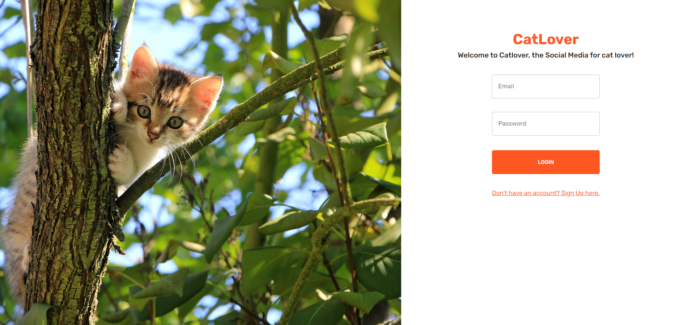
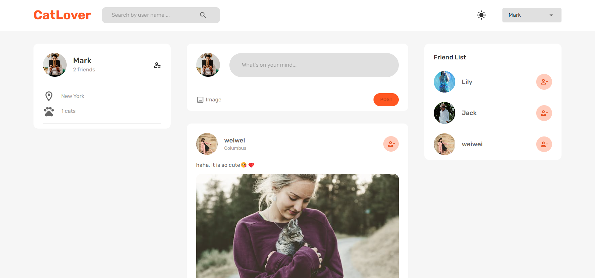
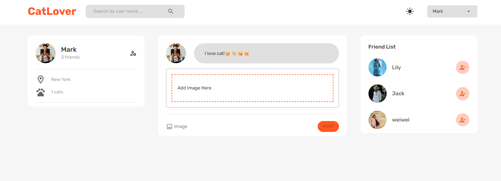
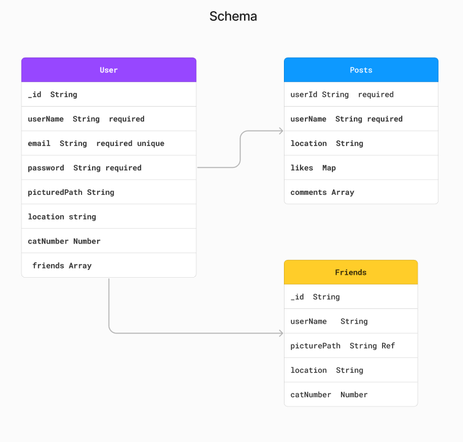
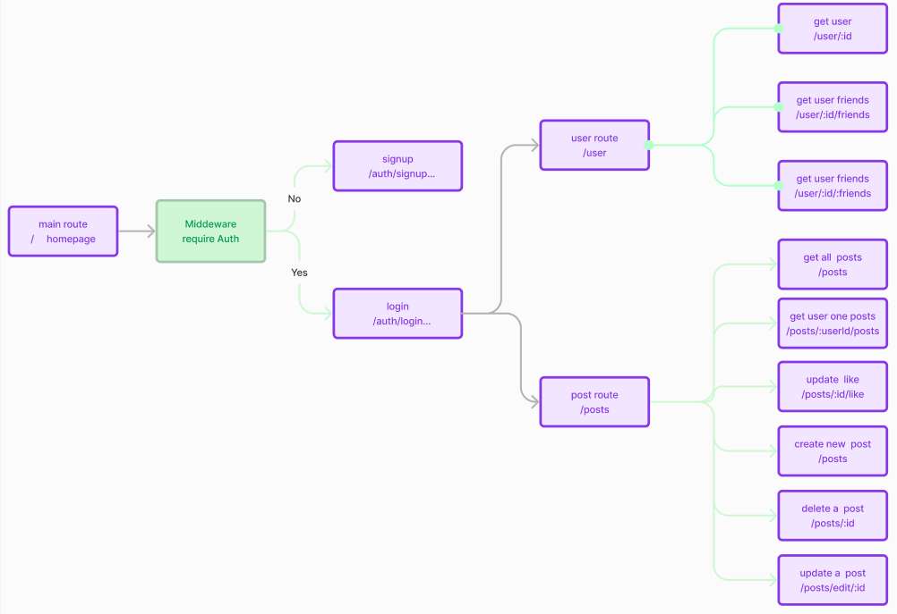

# CatLover

A social media web app for cat lovers — sign up, share photos of your cats, make friends, and like each other's posts.

**Live demo:** https://catlover.onrender.com
> Hosted on Render's free tier, so the first load may take about a minute while the server wakes up.

## Screenshots





## Features

- **Accounts** — sign up and log in with JWT authentication; passwords are hashed with bcrypt and never returned by the API. You can upload a profile picture when you sign up.
- **Posts** — create posts with a photo and a caption, and edit or delete your own posts.
- **Feed** — a home feed showing everyone's posts, with like / unlike.
- **Profiles** — each profile shows the user's posts, location, and how many cats they have.
- **Friends** — view a user's friends list and add or remove friends.
- **Forms & uploads** — Formik + Yup validation, and drag-and-drop image upload with React Dropzone.
- **Interface** — responsive Material UI layout with a custom theme and light/dark-friendly styling.

## Tech Stack

| Layer    | Technologies |
|----------|--------------|
| Frontend | React 18, Vite, Redux Toolkit, Redux Persist, React Router 6, Material UI (MUI), Formik, Yup, React Dropzone |
| Backend  | Node.js, Express, JWT, bcrypt, Multer, Helmet, Morgan |
| Database | MongoDB with Mongoose |

## Architecture

Data model:



API routes:



Main API endpoints (all post/user routes require a valid JWT):

| Method | Endpoint | Description |
|--------|----------|-------------|
| POST | `/api/auth/signup` | Create an account (with profile picture upload) |
| POST | `/api/auth/login` | Log in and receive a token |
| GET | `/api/users/:id` | Get a user's profile |
| GET | `/api/users/:id/friends` | Get a user's friends |
| PATCH | `/api/users/:id/:friendId` | Add or remove a friend |
| GET | `/api/posts` | Get the full feed |
| GET | `/api/posts/:userId/posts` | Get one user's posts |
| POST | `/api/posts` | Create a post (with photo upload) |
| PATCH | `/api/posts/:id` | Edit a post |
| PATCH | `/api/posts/:id/like` | Like or unlike a post |
| DELETE | `/api/posts/:id` | Delete a post |

## Run It Locally

```bash
git clone https://github.com/weiwei2222/catLover.git
cd catLover
npm install
```

Create a `.env` file in the project root:

```
DATABASE_URL=<your MongoDB connection string>
SECRET=<your JWT secret>
PORT=3005
```

Then build the frontend and start the server (Express serves the built app):

```bash
npm run build
npm start
```

For frontend development with hot reload, run `npm run dev` (Vite) alongside `npm start`.

## Planning

Project board: [Trello — CatLover](https://trello.com/b/jzsinVwf/catlover)

## Author

**Weiwei Lin** — front-end developer
Portfolio: https://weiwei2222.github.io/weiwei/ · GitHub: [@weiwei2222](https://github.com/weiwei2222)

---

*The previous version of this README is kept in [README_OLD.md](README_OLD.md).*
